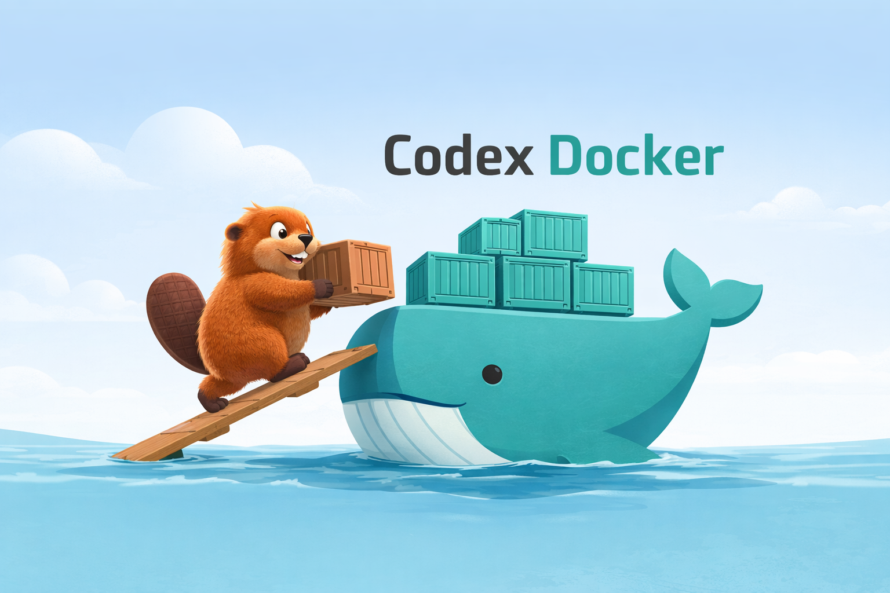

<p align="center">
  
</p>

# Codex Docker


A lightweight **Docker development environment for OpenAI Codex**.

Run the Codex CLI inside a clean, reproducible container without installing runtimes or managing dependencies locally. Your **workspace and authentication persist between runs**, making it easy to work with Codex safely and consistently.

## ✨ Overview

Codex includes a built-in sandbox for running commands. While useful, the sandbox environment is **ephemeral and limited**.

This project provides a **full Docker development environment**, giving Codex a stable and reproducible workspace.

## 🚀 Features

- Preconfigured **Codex CLI environment**
- No local installation of Node.js or Codex required
- **Persistent authentication** between runs
- Interactive development shell
- Simple Docker Compose setup
- Workspace mounted directly from the host machine
- Helpful shell shortcuts for common Codex commands

## 🧰 Included Toolchain

The container includes several runtimes commonly used in AI-assisted development workflows.

### Languages & Runtimes

| Language | Purpose |
|--------|--------|
| Node.js | JavaScript / TypeScript development |
| Python | scripting and AI tooling |
| Rust | systems programming |
| Go | backend and CLI development |
| Swift | Apple platform development |
| Ruby | scripting and web tooling |
| PHP | web development |
| Bun | modern JavaScript runtime |
| C++ | high-performance systems programming |
| Elixir | concurrent and distributed systems |
| Java | JVM ecosystem development |

### Build & Development Tools

| Tool | Purpose |
|------|--------|
| Bazel | build and test automation system |

These tools allow Codex to generate and run code across multiple ecosystems.

## ⚡ Quick Start

Clone the repository:

```bash
git clone https://github.com/james-chien/codex-docker.git
cd codex-docker
```

Build and start the container:

```bash
docker compose up -d --build
docker exec -it codex bash -l
```

### First-time setup

Authenticate Codex:

```bash
cdxl
```

Run Codex:

```bash
cdx
```

You are now using Codex inside the development container.

## 💻 Shell Commands

The container provides several shortcut commands.

| Command | Description |
|--------|-------------|
| `cdx`  | Run Codex (full access) |
| `cdxr` | Resume Codex session |
| `cdxs` | Show authentication status |
| `cdxl` | Login if needed |
| `cdxlo` | Logout |
| `cdxh` | Show helper commands |
| `cw` | Go to `/workspace` |

## 🤝 Contributing

Contributions are welcome.

Please read **CONTRIBUTING.md** for contribution guidelines.

## 📝 Changelog

Project history and release notes are maintained in **CHANGELOG.md**.

## 📄 License

MIT
