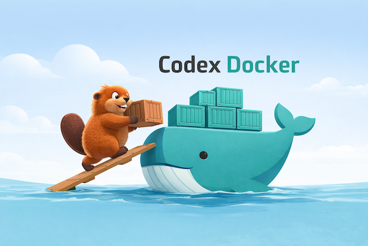

# Codex Docker



Run the OpenAI Codex CLI in a Debian-based Docker container with language toolchains and interactive Bash helpers. Your projects stay on the host, and Codex sign-in, settings, sessions, and the npm cache persist across container runs.

## Quick start

You need Git, Docker with the Compose plugin, and network access to download images and packages.

```bash
git clone https://github.com/james-chien/codex-docker.git
cd codex-docker
mkdir -p workspace
docker compose build codex
docker compose run --rm --service-ports codex
```

Put or clone your project under the host's `./workspace` directory. Inside the container, it appears under `/workspace`. Change into your project, run `cdxl` to sign in with device authentication, then run `cdx` to start Codex. Type `exit` to close the shell and remove the disposable container.

### Run in the background

Start the service and open an interactive shell:

```bash
docker compose up -d --build
docker compose exec codex bash
```

Use `docker compose logs codex` to inspect startup. Compose checks service health by running `codex --version`. When you're finished, run `docker compose down` from the host.

## Workspace, storage, and ports

| Host path | Container path | Contents |
| --- | --- | --- |
| `./workspace` | `/workspace` | Projects. Edits made in the container appear on the host. |
| `./codex` | `/root/.codex` | Codex authentication, configuration, and session data. |
| `./npm-cache` | `/root/.npm` | npm download cache. |

For a web app, listen on `0.0.0.0:8000` inside the container and open `http://127.0.0.1:8000` on the host. The `--service-ports` flag enables this mapping for disposable containers. Set `CODEX_HOST_PORT` to change the host port or `CODEX_BIND_IP` to expose it on another host interface. Set either variable in your shell or in a local `.env` file.

## Customize the image

The checked-in [Dockerfile](Dockerfile) is generated from [docker.config.json](docker.config.json) and includes every toolchain in the table below. To choose a subset or pin Codex, create `docker.local.json` in the repository root:

```json
{
    "runtimes": ["python", "go"],
    "codexVersion": "0.171.0"
}
```

- **`runtimes`** accepts the keys in the table below. An empty array keeps the base tools and Codex prerequisites. Node.js and npm are always included because the entrypoint installs and runs the npm-packaged Codex CLI.
- **`codexVersion`** is optional. Use an exact npm release to keep the same version across recreations. The default, `latest`, is resolved when a new container installs Codex. A restart reuses a working installation or restores the configured pin.

Run the generator with Node.js 22.18 or newer:

```bash
node scripts/generate-dockerfile.mts docker.local.json
CODEX_DOCKERFILE=Dockerfile.generated docker compose build codex
CODEX_DOCKERFILE=Dockerfile.generated docker compose run --rm --service-ports codex
```

The generator writes `Dockerfile.generated` by default. Pass a second path to write a different file. Add `--force` before the config path to replace an existing output. Set `CODEX_DOCKERFILE=Dockerfile.generated` in your local `.env` to use the custom image definition for subsequent Compose commands.

Default and custom Compose builds use the same local image tag. Rebuild when switching configurations. To restore the default image, clear `CODEX_DOCKERFILE` from your shell and `.env`, then run `docker compose build codex`.

### Toolchain reference

| Config key | What it adds |
| --- | --- |
| `node` | pnpm, Bun, and the TypeScript compiler. Node.js, npm, and npx are already in the base setup. |
| `python` | Python, pip, and uv. |
| `go` | Go compiler and module tooling. |
| `rust` | Rust compiler, rustup, and Cargo. |
| `java` | OpenJDK 28 early-access JDK. |
| `gcc` | GCC for C and C++, Make, CMake, binutils, and C library development headers. |
| `ruby` | Ruby, RubyGems, Bundler, and the libyaml runtime library. |
| `php` | PHP CLI and shared libraries for XML, SQLite, Oniguruma, Readline, Argon2, and Sodium. |
| `swift` | Linux Swift and Swift Package Manager, plus build tools including Clang and LLD. The upstream Swift base also provides Debian GCC. |

Images also include Git, curl, wget, GnuPG, and CA certificates. The [runtime installers](docker/scripts) add tools and system libraries during the build. Upstream image tags and tools installed with `@latest` can change over time.

## Bash shortcuts

| Command | What it does |
| --- | --- |
| `cdx`, `cdxr` | Start Codex or resume a session with normal approval and sandbox settings. |
| `cdxl`, `cdxs`, `cdxlo` | Sign in with device authentication, check sign-in status, or sign out. |
| `cdxv` | Show the installed Codex version. |
| `cdxdoctor` | Show Codex status, workspace paths, and installed tool versions. |
| `cdxcheck` | Verify that Codex runs and that the workspace and state directories are writable. Returns nonzero on failure. |
| `cdxupdate [version]` | Update the CLI in the current container. Defaults to `latest`. A restart restores any configured pin. |
| `cw`, `cdxh` | Go to the workspace or show shell help. |
| `cdxfull`, `cdxrfull` | Start or resume Codex with approval and sandbox checks bypassed. The workspace bind mount is writable. |

## Testing

Run these commands from the repository root with Node.js 22.18 or newer and Bash. The offline suite uses stubbed downloads and package installs.

```bash
node --test tests/*.test.mts
node scripts/generate-dockerfile.mts --check
```

The first command tests the generator, entrypoint, Bash helpers, and installer failure paths. The second exits nonzero if the checked-in Dockerfile differs from the default config. It leaves files untouched.

### Docker smoke test

Run the [smoke-test script](scripts/smoke-test-docker.mts) on a machine with Node.js 22.18 or newer, a Docker CLI connected to a running daemon, and network access for image pulls and package downloads:

```bash
node scripts/smoke-test-docker.mts
```

The script builds the checked-in default image and a generated minimal image, then starts each through the normal entrypoint. It runs `cdxcheck` in both disposable containers to verify that Codex runs and that the workspace and state directories are writable. It exits nonzero if a build or startup check fails. This test uses `docker build` and `docker run` directly. It requires no Compose service, host project mounts, or Codex sign-in.

## Contributing

See [CONTRIBUTING.md](CONTRIBUTING.md) for issue reporting and pull requests, [AGENTS.md](AGENTS.md) for repository conventions, and [CHANGELOG.md](CHANGELOG.md) for recent changes.

## License

[MIT](LICENSE)
